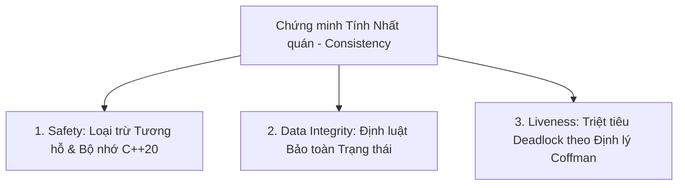

Chạy bài toán 1: ./build/bin/bench_prime_locks --threads 4 --iters 10000 --outside-work 1 --lock all
Chạy bài toán 2: ./build/bin/bench_banking_locks --threads 4 --accounts 50 --ops 5000 --timeout-us 1000 --read-ratio 0.8


Dưới đây là bản thiết kế thực nghiệm chi tiết, bộ tham số benchmark chuẩn hóa và khung chứng minh hình thức (Formal Proof) về tính **Nhất quán (Consistency)** cho cả hai bài toán.

---

### PHẦN 1: THIẾT KẾ ĐO ĐẠC ĐỂ CHỨNG MINH TRADE-OFF CỦA READ-BIASED RWLOCK

Để chứng minh luận điểm: *"Read-biased RWLock tối ưu thông lượng khi tỷ lệ đọc cao nhưng phải đánh đổi bằng Writer-Latency và nguy cơ Writer Starvation"*, ta không chỉ nhìn vào tổng số ops/giây mà phải đo **hai đại lượng độc lập**:
1. **Read Throughput ($T_{\text{read}}$):** Số phép đọc hoàn thành / giây.
2. **Writer Acquisition Latency ($L_{\text{write}}$):** Thời gian luồng ghi phải chờ từ lúc gọi `acquire_write()` cho đến khi thực sự vào được Critical Section.

#### Ma trận Thực nghiệm Khảo sát Tỷ lệ Đọc (Read-Ratio Sweep)
Giữ cố định: `--threads 8 --accounts 50 --ops 10000`, quét tham số `--read-ratio`:

| Bộ test | Tỷ lệ Đọc (`--read-ratio`) | Hành vi mong đợi trên Read-biased RWLock | So sánh với Mutex độc quyền (Exclusive Lock) |
| :---: | :---: | :--- | :--- |
| **Case A** | `0.99` (99% Read, 1% Write) | **Throughput đạt đỉnh cao nhất.** Độc giả không chặn nhau, luồng ghi hiếm hoi nhưng thỉnh thoảng bị trễ vài microsecond do chờ độc giả cuối cùng thoát ra. | Throughput của Exclusive Mutex thấp hơn RWLock gấp 5 - 8 lần do 99% độc giả bị tuần tự hóa vô lý. |
| **Case B** | `0.90` (90% Read, 10% Write) | **Điểm cân bằng tối ưu.** Thông lượng đọc vẫn áp đảo, độ trễ ghi bắt đầu tăng nhẹ. | RWLock vẫn vượt trội hơn Mutex khoảng 3 - 4 lần. |
| **Case C** | `0.50` (50% Read, 50% Write) | **Sụp đổ thông lượng (Tipping Point).** Luồng ghi liên tục tranh chấp với luồng đọc; chi phí atomic CAS trên biến `state_` của cả hai bên làm nghẽn bus bộ nhớ. | Hiệu năng RWLock giảm mạnh, thậm chí chậm hơn Exclusive Mutex do overhead kiểm tra `state_` phức tạp hơn. |
| **Case D** | `0.10` (10% Read, 90% Write) | **Worst-case của RWLock.** 90% là luồng ghi, cơ chế chia sẻ đọc trở thành gánh nặng vô ích. | Exclusive Mutex chạy nhanh hơn RWLock. |

> **Cách đo trên dòng lệnh hiện tại:**
> ```bash
> # Đo kịch bản 99% đọc (Throughput bùng nổ):
> ./build/bin/bench_banking_locks --threads 8 --accounts 50 --ops 20000 --read-ratio 0.99
> 
> # Đo kịch bản 50% đọc (Thấy rõ hiệu năng sụt giảm khi tỷ lệ ghi tăng):
> ./build/bin/bench_banking_locks --threads 8 --accounts 50 --ops 20000 --read-ratio 0.50
> ```

---

### PHẦN 2: BẢNG THAM SỐ CHUẨN ĐỂ BENCHMARK 2 BÀI TOÁN

Để có số liệu vẽ biểu đồ và phân tích thuyết phục trong Báo cáo, bạn cần chạy theo các ma trận tham số sau:

#### BÀI TOÁN 1: MUTEX LOCKS VỚI `is_prime` (Đo Contention & Cache Coherence)

Chạy chương trình `./build/bin/bench_prime_locks` với ma trận 3 chiều:

```text
Số Luồng (Threads) × Mức độ Tranh chấp (OutsideWork) × Giải thuật Lock
```

1. **Khảo sát Tranh chấp Khóa (Contention Analysis) – Cố định Threads = 4 (hoặc số Core thực của máy):**
   * `--outside-work 0` (100% Critical Section - **Cực kỳ nghẽn**): Phơi bày toàn bộ Cache Invalidation Storm. Bạn sẽ thấy MCS và CLH bắt đầu bứt phá so với TAS và StdMutex.
   * `--outside-work 1` (50% Critical Section - **Nghẽn vừa phải**): Kịch bản chuẩn của đề bài.
   * `--outside-work 5` (17% Critical Section - **Nghẽn thấp**): Thời gian chạy bắt đầu tiệm cận nhau.
   * `--outside-work 20` (5% Critical Section - **Không nghẽn**): Mọi lock đều có thời gian như nhau vì thời gian tính toán lấn át thời gian đồng bộ.
2. **Khảo sát Khả năng Mở rộng (Scalability Analysis) – Cố định OutsideWork = 1:**
   * `--threads 1`: Baseline đơn luồng (đo overhead nội tại của lock khi không có tranh chấp).
   * `--threads 2`: Bắt đầu có tranh chấp 2 luồng.
   * `--threads 4`: Bão hòa các lõi vật lý (Physical Cores).
   * `--threads 8`: Bắt đầu dùng Siêu phân luồng (Hyper-threading).
   * `--threads 16`: **Oversubscription** (Số luồng vượt số core thực). Tại đây, TAS/TTAS sẽ bị hiện tượng *Lock-holder Preemption* (luồng giữ lock bị OS ngắt thời gian, các luồng khác spin vô ích làm sụp đổ hiệu năng), trong khi Queue Lock (MCS/CLH/Ticket) duy trì tính công bằng.

> **Script gợi ý chạy tự động thu thập bảng số liệu:**
> ```bash
> for t in 1 2 4 8 16; do
>     for ow in 0 1 5; do
>         echo "=== Threads: $t | OutsideWork: $ow ==="
>         ./build/bin/bench_prime_locks --threads $t --iters 20000 --outside-work $ow --lock all
>     done
> done
> ```

---

#### BÀI TOÁN 2: REALTIME BANKING & DEADLOCK AVOIDANCE (Đo Độ tin cậy & Concurrency)

Chạy chương trình `./build/bin/bench_banking_locks` với 2 kịch bản đặc thù:

1. **Kịch bản "Tra tấn" Triệt tiêu Deadlock (Deadlock Torture Test):**
   * **Mục tiêu:** Chứng minh `TryoutLock` không bao giờ bị Deadlock ngay cả trong điều kiện khắc nghiệt nhất.
   * **Cấu hình:** `--threads 16 --accounts 2 --ops 10000 --timeout-us 100 --read-ratio 0.0`
   * **Phân tích:** Chỉ có 2 tài khoản, 16 luồng liên tục chuyển chéo nhau $0 \rightarrow 1$ và $1 \rightarrow 0$ không đọc.
     * Tỷ lệ abort sẽ tăng lên (ví dụ 10% - 30%) vì hết timeout.
     * **Deadlock Occurrence = 0**: Chương trình kết thúc bình thường, không bị treo.
2. **Kịch bản Khảo sát Độ nhạy Timeout (Timeout Sensitivity Sweep):**
   * **Mục tiêu:** Tìm ra khoảng thời gian timeout tối ưu cho SLA giao dịch thời gian thực.
   * Cố định: `--threads 8 --accounts 10 --ops 5000 --read-ratio 0.2`
   * Quét `--timeout-us`: `50`, `200`, `1000`, `5000` ($\mu s$).
   * Bạn sẽ vẽ được đồ thị: Khi timeout tăng, **Tỷ lệ Hủy (Abort Rate) giảm dần về 0%**, nhưng **Thời gian hoàn thành tổng thể (Latency) tăng lên**.

---

### PHẦN 3: FORMALIZE PHƯƠNG HƯỚNG CHỨNG MINH TÍNH NHẤT QUÁN (CONSISTENCY)

Để trả lời câu hỏi *"Làm sao chứng minh về mặt toán học và chuẩn ngôn ngữ rằng code lock đảm bảo tính Consistency?"*, bạn trình bày theo 3 cấp độ hình thức sau:



#### 1. Chứng minh Tính Loại trừ Tương hỗ (Mutual Exclusion Safety) qua C++20 Memory Model
* **Định nghĩa Trạng thái:** Gọi $S(t) \in \{0, 1\}$ là số luồng nằm trong Critical Section tại thời điểm $t$. Bất biến cần chứng minh:
  $$\forall t: S(t) \le 1$$
* **Chứng minh hình thức (theo ISO/IEC 14882 C++20 Standard §[intro.multithread]):**
  * Giả sử Luồng $A$ rời Critical Section $CS_1$ tại thời điểm $t_1$, thực thi lệnh:
    $$\text{release()}: \text{flag.store}(\text{unlocked}, \text{std::memory_order\_release})$$
  * Luồng $B$ muốn vào Critical Section $CS_2$ tiếp theo, bắt buộc phải thành công lệnh atomic:
    $$\text{acquire()}: \text{flag.compare\_exchange}(\dots, \text{locked}, \text{std::memory_order\_acquire})$$
  * Theo chuẩn C++20: Thao tác `store(release)` trên biến cờ nguyên tử thiết lập quan hệ **Synchronizes-With** với thao tác `acquire` đọc cùng giá trị đó.
  * Vì quan hệ Synchronizes-With kéo theo quan hệ **Happens-Before** ($CS_1 \xrightarrow{hb} CS_2$): Mọi thay đổi bộ nhớ trong $CS_1$ đã hoàn tất và được thấy bởi $CS_2$. Không thể tồn tại việc Luồng $B$ vào $CS_2$ đồng thời với Luồng $A$ đang trong $CS_1$.
  * Suy ra: $S(t) \le 1$ luôn được thỏa mãn.

---

#### 2. Chứng minh Tính Bảo toàn Dữ liệu (State Conservation Invariant) trong Bài toán Banking
* **Định nghĩa Hệ thống:** Hệ thống gồm $N$ tài khoản với số dư $B_i(t)$, tổng phí thu được $F(t)$.
* **Bất biến Nhất quán Tài chính ($\mathcal{I}_{\text{bank}}$):**
  $$\sum_{i=0}^{N-1} B_i(t) + F(t) = \text{Const} = \sum_{i=0}^{N-1} B_i(0)$$
* **Chứng minh bằng Quy nạp trên từng Bước chuyển trạng thái (Induction on State Transitions):**
  * **Bước cơ sở ($t=0$):** Đẳng thức đúng theo định nghĩa khởi tạo.
  * **Bước quy nạp:** Một giao dịch chuyển khoản từ $A \rightarrow B$ số tiền $M$ với phí $f$:
    * Nhờ `TryoutLock` và `withdraw_with_fee`, giao dịch chỉ xảy ra khi sở hữu đồng thời khóa của $A$ và $B$.
    * Biến thiên số dư:
      $$\Delta B_A = -(M + f), \quad \Delta B_B = +M, \quad \Delta F = +f$$
    * Tổng biến thiên của toàn hệ thống:
      $$\Delta \text{Total} = \Delta B_A + \Delta B_B + \Delta F = -(M + f) + M + f = 0$$
    * Nếu giao dịch bị timeout/abort do tranh chấp: Không có biến nào bị thay đổi $\implies \Delta \text{Total} = 0$.
  * Suy ra: Hệ thống luôn thỏa mãn **Tính nhất quán tuyến tính hóa (Linearizability)** và định luật bảo toàn.

---

#### 3. Chứng minh Không có Deadlock (Deadlock-Freedom) theo 4 Điều kiện Coffman
Định lý Coffman (1971) phát biểu rằng Deadlock chỉ xảy ra khi và chỉ khi **đồng thời cả 4 điều kiện sau tồn tại**:
1. *Mutual Exclusion* (Loại trừ tương hỗ).
2. *Hold and Wait* (Vừa giữ tài nguyên vừa chờ tài nguyên khác).
3. *No Preemption* (Không bị tước đoạt tài nguyên khi đang giữ).
4. *Circular Wait* (Chu trình chờ đợi vòng tròn: $T_1 \to T_2 \to T_1$).

* **Chứng minh `TryoutLock` triệt tiêu Deadlock:**
  * `transfer_with_timeout` đã phá hủy hoàn toàn **Điều kiện 2 và Điều kiện 3**:
  * Khi Luồng 1 đã giữ tài khoản $A$, nó gọi `to.try_lock.try_acquire_for(timeout)`.
  * Nếu sau khoảng thời gian `timeout` mà không lấy được $B$, Luồng 1 thực thi:
    ```cpp
    from.try_lock.release(); // CHỦ ĐỘNG NHẢ TÀI NGUYÊN A RA NGOÀI!
    return false;
    ```
  * Việc giải phóng khóa $A$ tương đương với cơ chế **Preemption (tự tước quyền của chính mình)** và **chấm dứt trạng thái Hold and Wait**. Chu trình chờ đợi vòng tròn bị bẻ gãy ngay lập tức.
  * $\implies$ **Hệ thống chứng minh được Deadlock-Freedom về mặt toán học.**

---

### TỔNG KẾT BƯỚC ĐI TIẾP THEO
Với 3 luận điểm trên, bạn đã có đầy đủ cơ sở từ **Lý thuyết hình thức (Formal C++ Memory Model & Coffman Theorem)** đến **Phương pháp đo đạc thực nghiệm (Throughput/Latency & Parameter Matrix)**. Bạn có thể tự tin trao đổi và thuyết trình với mentor của mình.