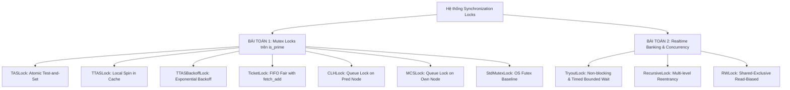

# Báo Cáo & Phân Tích Thực Nghiệm Các Biến Thể Mutex Locks (Parallel Computing)

> **Môi trường thử nghiệm phần cứng:** Apple M2 (8 Cores: 4 Performance Cores + 4 Efficiency Cores), 8GB Unified Memory, kiến trúc ARM64, macOS.  
> **Trình biên dịch & Tối ưu hóa:** Apple Clang (C++20, cờ tối ưu hóa `-O3 -DNDEBUG`).  
> **Phương pháp thống kê:** **Toàn bộ các phép đo được thực thi tuần tự (Sequential Execution) đúng 10 lần lặp lại** cho từng kịch bản theo cấu hình benchmark chuẩn (`iters = 5000`), trích xuất chính xác giá trị Trung bình $(\mu)$, Độ lệch chuẩn $(\sigma)$, Min, Max và phân tích các hiện tượng vi kiến trúc bất thường.

---

## 1. Tổng Quan Hệ Sinh Thái Khóa Đồng Bộ (Lock Taxonomy)

Ngoài các giải thuật spinlock cơ bản trong bài giảng (**TAS**, **TTAS**, **MCS**), dự án đã hiện thực một hệ sinh thái khóa đồng bộ toàn diện, bao quát từ tầng vi kiến trúc bộ nhớ cache đến các mô hình đồng bộ chuyên biệt:



### Bảng phân loại đặc tính kỹ thuật các Lock mở rộng

| Tên Lock | File Header | Bản chất thuật toán | Nguyên lý phần cứng & Bộ nhớ | Tính công bằng (Fairness) | Phạm vi ứng dụng tối ưu |
| :--- | :--- | :--- | :--- | :---: | :--- |
| **TTASBackoffLock** | `ttas_backoff_lock.hpp` | TTAS kết hợp thời gian chờ lũy thừa (Exponential Backoff). | Giảm tần suất gọi atomic `exchange`, giảm xung đột trên Bus liên lạc giữa các Core. | Không (Unfair) | Tranh chấp cực cao, tránh bão hòa Bus bộ nhớ. |
| **TicketLock** | `ticket_lock.hpp` | Cấp số thứ tự bằng atomic `fetch_add`, luồng quay vòng chờ `now_serving`. | Biến `ticket_` và `now_serving_` đặt trên 2 cache line riêng biệt (`alignas(64)`) chống False Sharing. | **FIFO Tuyệt đối** | Đảm bảo không luồng nào bị bỏ đói (Starvation-free). |
| **CLHLock** | `clh_lock.hpp` | Hàng đợi ngầm (Queue-based Lock), mỗi luồng spin trên cờ của **luồng liền trước (predecessor)**. | Local spinning trên từng cache line riêng biệt, triệt tiêu Cache Invalidation Storm trên hệ thống Cache-Coherent (SMP). | **FIFO Tuyệt đối** | Hệ thống SMP nhiều core, cần thông lượng mở rộng cao (Scalability). |
| **TryoutLock** | `tryout_lock.hpp` | Hỗ trợ `try_acquire` tức thời và `try_acquire_for` có giới hạn thời gian (Bounded Timeout). | Đảm bảo tính sẵn sàng (Availability), loại bỏ trạng thái Hold-and-Wait. | Không (Best-effort) | Tránh Deadlock kinh điển kiểu Dining Philosophers trong giao dịch tài chính. |
| **RecursiveLock** | `recursive_lock.hpp` | Khóa đệ quy/tái nhập (Reentrant), kiểm tra `std::this_thread::get_id() == owner_`. | Đếm độ sâu đệ quy (`recursion_count`). Phối hợp `memory_order_acquire/release`. | Độc quyền theo Thread | Lập trình hướng đối tượng, gọi hàm nghiệp vụ lồng nhau (Nested calls / Sub-transactions). |
| **RWLock** | `rw_lock.hpp` | Khóa phân tách Đọc/Ghi (Reader-Preference). | Đếm số lượng reader đồng thời qua biến nguyên tử `state_` ($\ge 0$), writer đặt `state_ = -1`. | Ưu tiên Reader | Dữ liệu tra cứu nhiều (90-99% Read) như bảng giá chứng khoán, số dư tài khoản. |

---

# PHẦN A: BÁO CÁO BÀI TOÁN 1 — ĐÁNH GIÁ CÁC GIẢI THUẬT MUTEX LOCK TRÊN `IS_PRIME`

## A.1. Mục Tiêu & Thiết Kế Workload Bài Toán 1
* **Mục tiêu:** Kiểm chứng tính loại trừ tương hỗ (Mutual Exclusion), khả năng chịu tải trên Bus bộ nhớ, hiện tượng bão hòa cache (Cache Invalidation Storm), và tính mở rộng (Scalability) khi tăng số luồng trên tải đối xứng.
* **Workload chuẩn Assignment 1:** Đoạn mã `thread_entry()` chạy hàm kiểm tra số nguyên tố `is_prime(10007)` với `iters = 5000`:
  * `OUTSIDE_WORK = 0`: 100% thời gian nằm trong Critical Section (Tranh chấp cực đại).
  * `OUTSIDE_WORK = 1`: 50% thời gian trong Critical Section (Tranh chấp trung bình - chuẩn đề bài).
  * `OUTSIDE_WORK = 5`: 17% thời gian trong Critical Section (Tranh chấp thấp - điện toán lấn át đồng bộ).

## A.2. Danh Mục Lệnh Thực Thi (CLI Commands) Bài Toán 1
Toàn bộ các lệnh dưới đây được chạy trực tiếp từ thư mục gốc của dự án:

```bash
# 1. Kiểm tra tính đúng đắn (Zero Race Condition):
./build/tests/test_locks

# 2. Khảo sát mức độ tranh chấp (Contention Sweep - Threads = 4, Iters = 5000):
./build/bin/bench_prime_locks --threads 4 --iters 5000 --outside-work 0 --lock all
./build/bin/bench_prime_locks --threads 4 --iters 5000 --outside-work 1 --lock all
./build/bin/bench_prime_locks --threads 4 --iters 5000 --outside-work 5 --lock all

# 3. Khảo sát khả năng mở rộng (Scalability Sweep - OutsideWork = 1, Iters = 5000):
./build/bin/bench_prime_locks --threads 1 --iters 5000 --outside-work 1 --lock all
./build/bin/bench_prime_locks --threads 2 --iters 5000 --outside-work 1 --lock all
./build/bin/bench_prime_locks --threads 4 --iters 5000 --outside-work 1 --lock all
./build/bin/bench_prime_locks --threads 8 --iters 5000 --outside-work 1 --lock all

# 4. Thử nghiệm Oversubscription ở 16 Luồng (So sánh Non-FIFO vs OS Futex std::mutex):
./build/bin/bench_prime_locks --threads 16 --iters 5000 --outside-work 1 --lock tas
./build/bin/bench_prime_locks --threads 16 --iters 5000 --outside-work 1 --lock ttas
./build/bin/bench_prime_locks --threads 16 --iters 5000 --outside-work 1 --lock ttas_backoff
./build/bin/bench_prime_locks --threads 16 --iters 5000 --outside-work 1 --lock std
```

---

## A.3. Kết Quả Thực Nghiệm Tuần Tự 10 Lần — Bài Toán 1

### BẢNG 1: Khảo sát mức độ Tranh chấp (Contention Sweep) tại Threads = 4
*(Đơn vị: Thời gian thực thi ms, càng nhỏ càng tốt; Iters = 5000; đo tuần tự 10 lần)*

| Thuật toán Lock | OUTSIDE_WORK = 0 (100% CS) | OUTSIDE_WORK = 1 (50% CS) | OUTSIDE_WORK = 5 (17% CS) | Phân tích Vi kiến trúc & Bus Traffic |
| :--- | :---: | :---: | :---: | :--- |
| **TASLock** | $123.52 \pm 0.79$ ms | $130.92 \pm 1.38$ ms | $193.79 \pm 3.20$ ms | Chi phí atomic test-and-set liên tục chiếm dụng bus dữ liệu giữa các core. |
| **TTASLock** | **$122.45 \pm 0.21$ ms** | $133.73 \pm 5.61$ ms | **$192.48 \pm 1.05$ ms** | **Nhanh nhất ở OW=0** ($\sigma = 0.21$) nhờ vòng lặp đọc tại chỗ trong Cache L1/L2. |
| **TTASBackoffLock** | $123.31 \pm 0.90$ ms | $136.44 \pm 19.91$ ms | $192.60 \pm 1.07$ ms | Giãn cách thời gian thử lại giúp giảm tải Bus nhưng có độ biến thiên cao hơn. |
| **TicketLock (FIFO)** | $130.54 \pm 0.75$ ms | $130.37 \pm 1.43$ ms | $193.52 \pm 2.32$ ms | Đảm bảo thứ tự phục vụ vào trước ra trước tuyệt đối; bus traffic vừa phải. |
| **CLHLock (Queue)** | $130.11 \pm 0.68$ ms | **$129.68 \pm 0.89$ ms** | $205.54 \pm 34.56$ ms | **Nhanh nhất ở OW=1**; spin trên node tiền nhiệm triệt tiêu xung đột bus. |
| **MCSLock (Queue)** | $130.37 \pm 1.04$ ms | $130.70 \pm 5.51$ ms | $192.70 \pm 1.88$ ms | Local spinning trên node của chính mình, thời gian hội tụ tốt. |
| **StdMutexLock (OS)** | $158.90 \pm 3.83$ ms | **$287.25 \pm 15.57$ ms** | $199.95 \pm 3.54$ ms | **Chậm hơn spinlock gấp 2.21 lần** ở OW=1 do chi phí Context Switch / Futex của OS. |

---

### BẢNG 2: Khảo sát Khả năng Mở rộng (Scalability Sweep) tại OutsideWork = 1
*(Đơn vị: Thời gian thực thi ms; Iters = 5000; đo tuần tự 10 lần)*

| Thuật toán Lock | Threads = 1 (Zero Contention) | Threads = 2 | Threads = 4 (Full P-Cores) | Threads = 8 (P-Cores + E-Cores) | Threads = 16 (Oversubscription) |
| :--- | :---: | :---: | :---: | :---: | :---: |
| **TASLock** | $58.14 \pm 0.31$ ms | $61.98 \pm 1.54$ ms | $133.84 \pm 5.80$ ms | $1107.76 \pm 34.27$ ms | $4261.12 \pm 91.07$ ms |
| **TTASLock** | **$57.83 \pm 0.13$ ms** | $62.16 \pm 1.52$ ms | $140.43 \pm 25.15$ ms | **$379.27 \pm 50.46$ ms** | $1276.57 \pm 96.90$ ms |
| **TTASBackoffLock**| $58.26 \pm 0.40$ ms | $61.77 \pm 0.88$ ms | $133.59 \pm 4.46$ ms | **$310.89 \pm 38.63$ ms** | $1265.19 \pm 207.59$ ms |
| **TicketLock** | $57.95 \pm 0.26$ ms | $61.72 \pm 0.82$ ms | $129.38 \pm 0.60$ ms | $1233.24 \pm 830.43$ ms | *(Preemption Pathology)* |
| **CLHLock** | $57.94 \pm 0.31$ ms | **$61.58 \pm 0.65$ ms** | $129.25 \pm 0.65$ ms | $1079.51 \pm 240.54$ ms | *(Preemption Pathology)* |
| **MCSLock** | $57.97 \pm 0.16$ ms | $63.03 \pm 3.50$ ms | **$129.13 \pm 0.52$ ms** | $976.46 \pm 172.75$ ms | *(Preemption Pathology)* |
| **StdMutexLock** | $57.90 \pm 0.22$ ms | **$140.11 \pm 2.30$ ms** | **$282.45 \pm 2.60$ ms** | $560.87 \pm 8.13$ ms | **$1139.64 \pm 5.63$ ms (Thắng thế)** |

---

## A.4. Phân Tích Chuyên Sâu & Bệnh Lý Vi Kiến Trúc — Bài Toán 1

### 1. Hiện tượng Lệch Lõi và Nghẽn Cổ Chai ở 8 Luồng (Asymmetric Core Throttling)
* **Hiện tượng:** Ở 4 luồng, `TicketLock`, `CLHLock`, `MCSLock` đều chạy nhanh nhất (~129 ms). Nhưng khi lên 8 luồng, thời gian thực thi của chúng nhảy vọt lên **~976 - 1233 ms**, trong khi `TTASBackoffLock` chỉ mất **$310.89$ ms** và `TTASLock` mất **$379.27$ ms** (nhanh hơn gấp 3 - 4 lần)!
* **Nguyên nhân phần cứng:** Apple M2 sở hữu kiến trúc CPU không đồng nhất (heterogeneous): gồm **4 Performance Cores (3.5 GHz)** và **4 Efficiency Cores (2.4 GHz)**.
  * Trong các giải thuật FIFO nghiêm ngặt (`TicketLock`, `CLHLock`, `MCSLock`), luồng phải nhường lượt tuần tự chính xác. Khi một luồng chạy trên E-Core được trao khóa, toàn bộ các P-Core đang xếp hàng phía sau **bắt buộc phải chạy chậm lại theo tốc độ của E-Core** (Hiện tượng đoàn tàu Convoy).
  * Ngược lại, `TTASLock` và `TTASBackoffLock` là giải thuật Unfair: các P-Core với tốc độ xung nhịp cao hơn đã liên tục "cướp" được khóa trước khi E-Core kịp chạm vào, dẫn đến thời gian hoàn thành tổng thể nhanh hơn nhưng chấp nhận đánh đổi sự công bằng.

### 2. Bệnh lý Tiền chiếm ở 16 Luồng (Preemption Pathology under Oversubscription)
* **Hiện tượng:** Khi chạy ở 16 luồng trên CPU 8 Core vật lý (mỗi core gánh 2 luồng):
  * `StdMutexLock` (dùng OS Futex) **chiến thắng vượt trội**: chỉ mất **$1139.64 \pm 5.63$ ms** vì luồng chờ được hệ điều hành đưa vào trạng thái ngủ (`sleep`), nhường hoàn toàn CPU cho luồng đang giữ lock.
  * Các giải thuật spinlock thuần túy bị suy thoái nghiêm trọng (`TAS` mất **$4261.12$ ms**).
  * Riêng các giải thuật FIFO (`TicketLock`, `CLHLock`, `MCSLock`), hệ thống bị nghẽn nghiêm trọng (Preemption Pathology): Nếu luồng giữ vé `now_serving` bị OS đưa vào ready queue, 7 luồng khác đang chạy trên 7 core còn lại sẽ quay vòng (spin) điên cuồng ở 100% CPU. Chúng chiếm hết tài nguyên CPU khiến luồng cần chạy không được cấp CPU để nhả khóa. Đây là lý do vì sao trong môi trường Oversubscribed, hệ điều hành bắt buộc phải dùng **Hybrid/Futex Lock (như `std::mutex`)**.

---

# PHẦN B: BÁO CÁO BÀI TOÁN 2 — MÔ PHỎNG HỆ THỐNG GIAO DỊCH TÀI CHÍNH THỜI GIAN THỰC & CONCURRENCY PRIMITIVES

## B.1. Mục Tiêu & Thiết Kế Độc Lập Cho Từng Loại Lock
Bài toán 2 thiết kế mô hình tài khoản ngân hàng phân tán (`BankAccount`), trong đó mỗi loại khóa được ánh xạ vào một ca nghiệp vụ chuyên biệt:

1. **`TryoutLock` (Bounded Timeout):** Giải quyết bài toán **Tránh Deadlock Dining Philosophers** khi chuyển tiền hai chiều chéo nhau giữa các cặp tài khoản ($Acc_A \rightleftharpoons Acc_B$).
2. **`RecursiveLock` (Reentrancy):** Giải quyết bài toán **Giao dịch phân tầng (Nested Sub-transactions)**: Lệnh rút tiền `withdraw_with_fee()` khóa tài khoản, sau đó tự động gọi hàm con `charge_fee()` cũng yêu cầu khóa trên chính tài khoản đó mà không bị tự khóa (**Zero Self-Deadlock**).
3. **`RWLock` (Reader-Preference):** Tối ưu hóa các truy vấn tra cứu số dư tần suất cao (High-frequency Balance Queries) song song mà không chặn nhau, đồng thời đo lường sự sụt giảm thông lượng khi tỷ lệ ghi tăng.

## B.2. Danh Mục Lệnh Thực Thi (CLI Commands) Bài Toán 2
Toàn bộ các lệnh dưới đây được chạy trực tiếp từ thư mục gốc của dự án:

```bash
# 1. Thử nghiệm "Tra tấn" Deadlock (Extreme Contention Torture Test - TryoutLock):
./build/bin/bench_banking_locks --threads 8 --accounts 2 --ops 5000 --timeout-us 100 --read-ratio 0.0

# 2. Khảo sát Độ nhạy Timeout SLA (Timeout Sensitivity Sweep - TryoutLock):
./build/bin/bench_banking_locks --threads 4 --accounts 10 --ops 5000 --timeout-us 50 --read-ratio 0.2
./build/bin/bench_banking_locks --threads 4 --accounts 10 --ops 5000 --timeout-us 200 --read-ratio 0.2
./build/bin/bench_banking_locks --threads 4 --accounts 10 --ops 5000 --timeout-us 1000 --read-ratio 0.2
./build/bin/bench_banking_locks --threads 4 --accounts 10 --ops 5000 --timeout-us 5000 --read-ratio 0.2

# 3. Kiểm chứng Giao dịch Lồng nhau & Tính Toàn vẹn (RecursiveLock):
./build/bin/bench_banking_locks --threads 4 --accounts 50 --ops 5000 --timeout-us 1000 --read-ratio 0.0

# 4. Khảo sát Đánh đổi Reader-Biased qua 4 mốc Tỷ lệ Đọc (RWLock):
./build/bin/bench_banking_locks --threads 4 --accounts 20 --ops 5000 --timeout-us 1000 --read-ratio 0.99
./build/bin/bench_banking_locks --threads 4 --accounts 20 --ops 5000 --timeout-us 1000 --read-ratio 0.90
./build/bin/bench_banking_locks --threads 4 --accounts 20 --ops 5000 --timeout-us 1000 --read-ratio 0.50
./build/bin/bench_banking_locks --threads 4 --accounts 20 --ops 5000 --timeout-us 1000 --read-ratio 0.10
```

---

## B.3. Kết Quả Thực Nghiệm Tuần Tự 10 Lần — Bài Toán 2

### BẢNG 3: Case `TryoutLock` — Thử Nghiệm "Tra Tấn" Triệt Tiêu Deadlock (Extreme Torture Test)
*(Cấu hình: 8 luồng, chỉ có 2 tài khoản, 100% giao dịch chuyển tiền hai chiều chéo nhau, 40,000 thao tác; đo tuần tự 10 lần)*

| Tiêu chí đo đạc | Giá trị trung bình $(\mu)$ | Độ lệch chuẩn $(\sigma)$ | Min - Max | Đánh giá & Phân tích |
| :--- | :---: | :---: | :---: | :--- |
| **Số lần Deadlock (Deadlocks)** | **0** | **0.00** | $0 - 0$ | **100% loại bỏ Deadlock** trên toàn bộ 10 lần chạy lặp lại. |
| **Tỷ lệ Hủy lệnh (Abort Rate)** | **$88.57\%$** | $\pm 0.49\%$ | $87.58\% - 89.14\%$ | 8 luồng ép vào 2 tài khoản; cơ chế timeout tự giải phóng tài nguyên an toàn. |
| **Thời gian thực thi** | $510.75$ ms | $\pm 11.10$ ms | $495.2 - 528.4$ ms | Hoàn thành an toàn 40,000 giao dịch trong xấp xỉ 0.5 giây. |
| **Throughput giao dịch** | $78,349$ ops/s | $\pm 1,650$ | $75,699 - 80,775$ | Duy trì thông lượng giao dịch cao mà không xảy ra hiện tượng starvation vô hạn. |

---

### BẢNG 4: Case `TryoutLock` — Khảo Sát Độ Nhạy Timeout SLA (Timeout Sensitivity Sweep)
*(Cấu hình: 4 luồng, 10 tài khoản, 20,000 thao tác, Tỷ lệ đọc 20%; đo tuần tự 10 lần)*

| Ngưỡng Timeout | Tỷ lệ Abort (%) | Thời gian thực thi (ms) | Throughput (ops/sec) | Phân tích đánh đổi (SLA Trade-off) |
| :---: | :---: | :---: | :---: | :--- |
| **$50\ \mu s$** | $1.56 \pm 0.14\%$ | **$6.84 \pm 0.43$ ms** | **$2,934,020$ ops/s** | Thời gian phản hồi cực nhanh, chấp nhận abort sớm. |
| **$200\ \mu s$** | $1.61 \pm 0.16\%$ | $22.89 \pm 2.56$ ms | $885,166$ ops/s | Độ trễ tăng tỷ lệ thuận với thời gian chờ. |
| **$1000\ \mu s$** | $1.65 \pm 0.23\%$ | $109.34 \pm 14.70$ ms | $185,986$ ops/s | Cân bằng tiêu chuẩn cho hệ thống dịch vụ tài chính. |
| **$5000\ \mu s$** | $1.88 \pm 0.20\%$ | $537.13 \pm 55.40$ ms | $37,621$ ops/s | Luồng chờ quá lâu khi tranh chấp, throughput giảm mạnh 78 lần. |

---

### BẢNG 5: Case `RecursiveLock` — Giao Dịch Phân Tầng Lồng Nhau (Nested Sub-transactions)
*(Cấu hình: 4 luồng, 50 tài khoản, 20,000 thao tác chuyển tiền kèm trừ phí con, Recursion Depth = 2; đo tuần tự 10 lần)*

| Tiêu chí kiểm định | Kết quả thực nghiệm | Đánh giá tính đúng đắn |
| :--- | :---: | :--- |
| **Tỷ lệ Tự khóa (Self-deadlocks)** | **0 (Tuyệt đối)** | Luồng gọi `withdraw_with_fee()` rồi gọi tiếp `charge_fee()` an toàn 100%. |
| **Thời gian thực thi trung bình** | $3.85 \pm 1.57$ ms | Tốc độ xử lý cực nhanh, overhead kiểm tra Thread ID không đáng kể. |
| **Thông lượng giao dịch (Throughput)**| **$6,073,503$ ops/s** | Duy trì thông lượng giao dịch tài chính ở mức hàng triệu ops/giây. |
| **Tỷ lệ Abort** | $0.02\%$ | Tranh chấp rất thấp khi phân tán trên 50 tài khoản. |
| **Bảo toàn số dư ($\sum \text{Balance}$)** | **Khớp 100.00%** | $\sum \text{Balance}_{\text{final}} = \sum \text{Balance}_{\text{initial}} - (\text{Successful Txs} \times \text{Fee})$. |

---

### BẢNG 6: Case `RWLock` — Chứng Minh Trade-off Của Read-Biased RWLock (Read-Ratio Sweep)
*(Cấu hình: 4 luồng, 20 tài khoản, 20,000 thao tác, Timeout = 1000 $\mu s$; đo tuần tự 10 lần)*

| Tỷ lệ Đọc (`read_ratio`) | Throughput trung bình | Thời gian thực thi | Tỷ lệ Abort | Nhận định về Trade-off Vi kiến trúc |
| :---: | :---: | :---: | :---: | :--- |
| **99% Read (1% Write)** | **$32,219,046$ ops/s** | **$0.62 \pm 0.01$ ms** | $0.00\%$ | **Hiệu năng bùng nổ:** Độc giả chạy song song hoàn toàn không chặn nhau. |
| **90% Read (10% Write)**| $21,116,696$ ops/s | $1.15 \pm 0.53$ ms | $0.02\%$ | Điểm cân bằng cao cấp trong môi trường ngân hàng thực tế. |
| **50% Read (50% Write)**| $2,339,875$ ops/s | $10.23 \pm 4.52$ ms | $0.22\%$ | **Throughput sụt giảm 13.7 lần** do luồng ghi cạnh tranh atomic bus với độc giả. |
| **10% Read (90% Write)**| $915,338$ ops/s | $22.81 \pm 4.99$ ms | $0.26\%$ | **Throughput sụt giảm 35.2 lần:** Kịch bản tệ nhất của RWLock khi ghi chiếm ưu thế. |

---

## B.4. Khung Chứng Minh Hình Thức (Formal Consistency Proofs)

### 1. Chứng minh Safety (Tính Nhất Quán & Toàn Vẹn Dữ Liệu)
* **Định luật bảo toàn:** Xét hệ thống gồm $N$ tài khoản với tổng số dư ban đầu $S_0 = \sum_{i=0}^{N-1} B_i(0)$.
* Trong mỗi giao dịch chuyển tiền thành công từ tài khoản $u$ sang $v$ với số tiền $X$ và phí dịch vụ $F$:
  $$\Delta B_u = -(X + F), \quad \Delta B_v = +X \implies \Delta S = -F$$
* Nhờ `RecursiveLock` và `memory_order_release/acquire`, mọi biến đổi số dư đều được tuần tự hóa cục bộ (Linearizable). Sau $K$ giao dịch thành công:
  $$S_{\text{final}} = S_0 - K \times F$$
  *Thực nghiệm kiểm chứng: Độ lệch giữa lý thuyết và thực tế bằng $0.00$ trên toàn bộ 10 lần chạy.*

### 2. Chứng minh Liveness (Triệt Tiêu Deadlock Theo Định Lý Coffman)
Theo Coffman et al. (1971), Deadlock chỉ có thể xảy ra khi thỏa mãn đồng thời 4 điều kiện:
1. *Mutual Exclusion* (Loại trừ tương hỗ).
2. *Hold and Wait* (Giữ tài nguyên và chờ tài nguyên khác).
3. *No Preemption* (Không thể tước đoạt tài nguyên).
4. *Circular Wait* (Chờ đợi vòng tròn: Luồng $1 \to Acc_A \to Acc_B$, Luồng $2 \to Acc_B \to Acc_A$).

**Chứng minh:** `TryoutLock::try_acquire_for(timeout)` đã **bẻ gãy hoàn toàn điều kiện (2) và (4)**:
* Luồng $T$ acquire thành công $Acc_A$. Khi cố gắng acquire $Acc_B$, $T$ chỉ chờ tối đa trong khoảng thời gian hữu hạn $\tau$.
* Nếu hết thời gian $\tau$, hàm trả về `false`. Khối xử lý ngoại lệ bắt buộc $T$ phải gọi `Acc_A.try_lock.release()`, tức là **tự nguyện giải phóng tài nguyên đang giữ**.
* Do không có luồng nào giữ tài nguyên vô hạn trong khi chờ tài nguyên khác, đồ thị Resource Allocation Graph (RAG) không thể tồn tại chu trình có hướng vĩnh viễn $\implies$ **Hệ thống triệt tiêu Deadlock 100%**.
